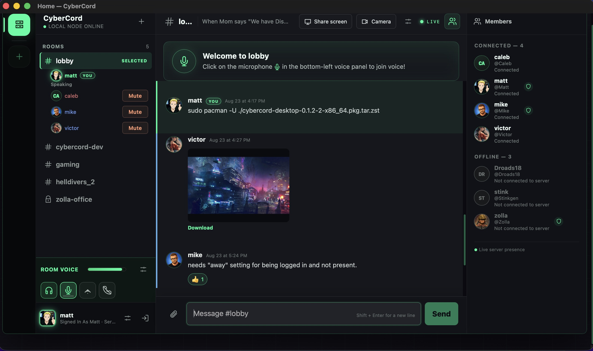
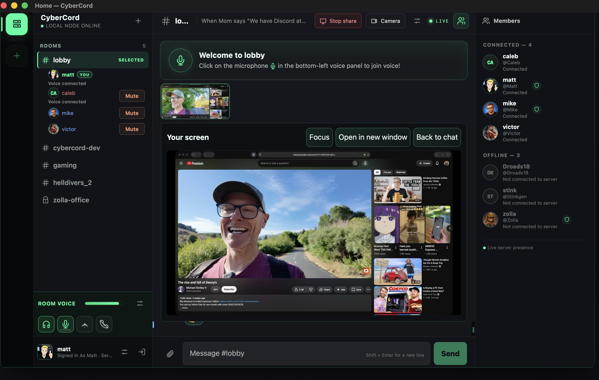
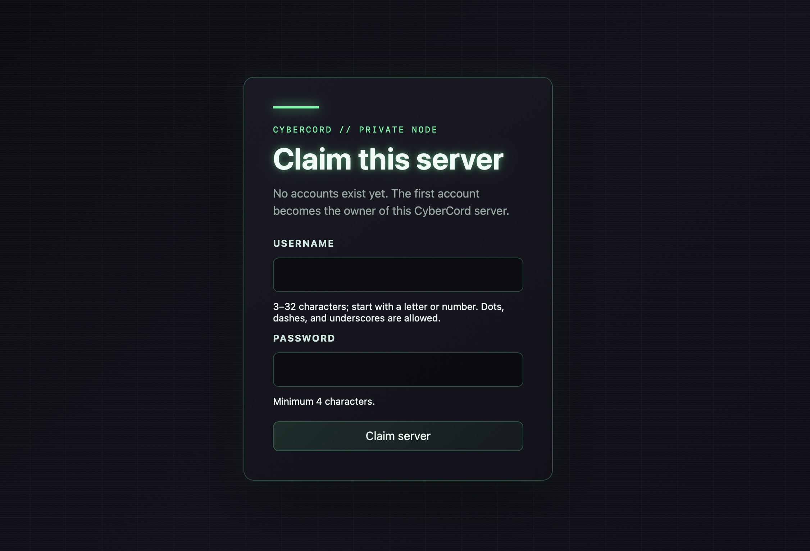
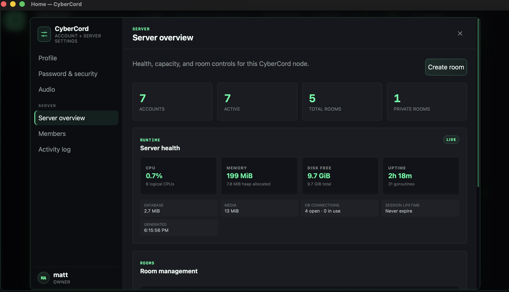
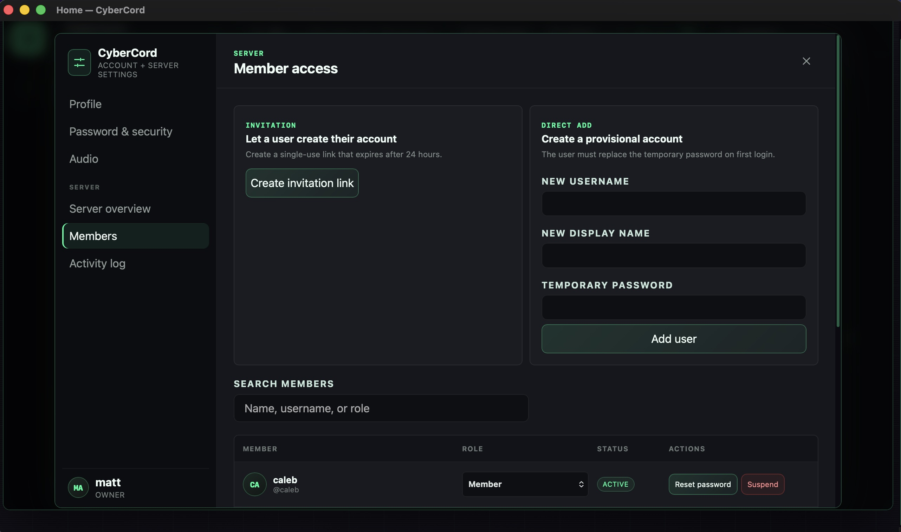
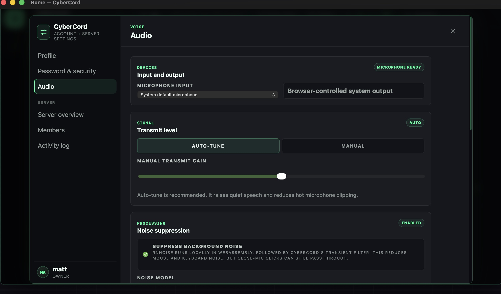
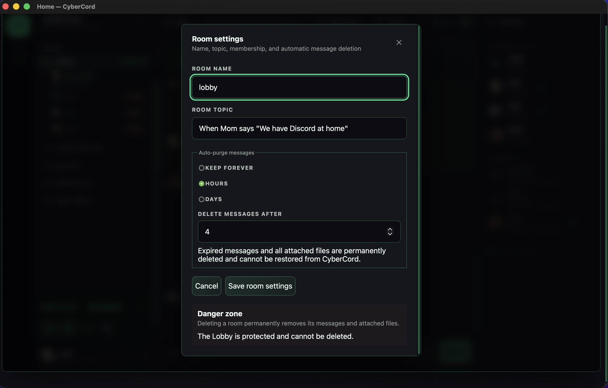

# CyberCord

> A privacy-first 🧐, secure 🔒, local 🧑‍💻 chat / voice / video social platform.
> Tiny. Private. Yours.

<p align="center">
  <a href="https://github.com/RamboRogers/cybercordnow/releases/latest"></a>
  <a href="https://github.com/RamboRogers/cybercordnow/releases"></a>
  <a href="https://github.com/RamboRogers/cybercordnow/stargazers"></a>
  <a href="https://github.com/RamboRogers/cybercordnow/pkgs/container/cybercord-server"></a>
  <a href="LICENSE"></a>
</p>

<!-- Hero: main workspace — chat, voice, members -->
<p align="center">
  
</p>

CyberCord is a self-hosted room platform that runs in **a single container from a single self-contained binary**. `docker run` it, open the URL, claim it — that's the whole setup. It serves its own interface to desktop and mobile browsers, offers optional native desktop clients, and carries text, files, voice, and video through **one HTTPS endpoint**.

Keep your community on infrastructure you control. Room history can expire on a timer, and CyberCord does not record live voice or screen/camera shares. Self-hosting is a trust choice, not end-to-end encryption: see [Security and privacy](#-security-and-privacy) for the protections and their limits.

## ✦ 2.1 Highlights

**No client changes are needed: 2.1.3 is a server update.** Existing clients load the
updated interface from your server; reload or restart them after the server upgrade.

- **Voice bandwidth you control** — Settings → Audio → Voice bandwidth includes **Low bandwidth — selected**, which holds Opus at 12 kbps up and 12 kbps down until you switch back to Auto; CPU Light stays an independent performance choice.
- **Eleven complete themes** — Settings → Appearance is available to every member, with dark and light choices, clearer labeled controls, visible keyboard focus, and reduced-motion support. Switching themes keeps voice, sharing, and unsent drafts intact.
- **More reliable voice on uneven links** — Auto starts at normal quality instead of staying in low quality after short conversations; voice diagnostics show the live codec, rate, and buffer state; brief recovery keeps Opus when the codec still works and preserves mute/deafen instead of treating every pause as a disconnect.
- **Readable unread activity** — other rooms get an accessible neon shimmer, bounded unread/mention counts, and reduced-motion behavior that keeps counts available without animation.
- **Directed mentions and notifications** — type `@username` to complete current-room members, then CyberCord can show a directed toast and rate-limited ding; Settings → Notifications can opt in to browser/OS notifications after permission.
- **Server-only update** — update the server/WebUI image to 2.1.3 and reload or restart existing browser tabs, PWAs, or desktop shells; Windows/Linux desktop v2.0.0 and macOS v0.1.2 downloads remain unchanged.

Voice starts at normal quality without a bitrate ramp and can recover more promptly after verified healthy audio. Automatic audio adjustment and fixed Low bandwidth do not pause screen/camera sharing or attachment uploads. The old automatic “Protecting audio” control state is removed; stream details retain useful diagnostics. Automated and synthetic-browser results are not a physical-device, acoustic, Wi-Fi, or long-duration performance guarantee.

---

## ✦ Why CyberCord

| | |
|---|---|
| 🧐 **Privacy first** | Optional room-history expiry and live-only media, with explicit retention and trust boundaries below |
| 🔒 **Secure** | Argon2id passwords, opaque sessions, CSRF protection, flood control, invite-only by default |
| 🧑‍💻 **Local** | Your server, your hardware, your data. No CyberCord cloud account or vendor analytics service required |
| 📦 **Tiny** | One container, one self-contained Go binary, embedded browser UI — pure-Go SQLite, no external database |
| 🔌 **One endpoint** | One HTTPS endpoint carries text, files, voice, video, and screen share through Caddy or another WebSocket-capable reverse proxy |
| 🖥️ **Easy to use** | Built-in desktop/mobile browser interface; optional native desktop clients point at your server |

## ✦ Key Features

- **Rooms with multiple webcams and desktop streaming users at once**
- **Text chat with rich media and directed mentions** — video, files, images, emoji reactions, accessible unread counts, and `@username` room-member completion
- **Rooms with privacy settings** — public or private with explicit membership lists
- **Dissolving chat** — auto-delete messages after X hours or days, attachments included
- **Clear room voice** — noise suppression, echo cancellation, fixed low-bandwidth Opus mode, and independent CPU Light help conversations stay easy to follow
- **Personal appearance** — eleven complete dark/light themes, remembered locally per account and server, with dismissible lobby guidance
- **One HTTPS endpoint for all app traffic** — text, files, voice, video, and screen share

<p align="center">
  
</p>

## ⚡️ Coming Soon

- **Federation** — cross-server room federation, federated chat, and shared media 💿
- **Polish** — ongoing bug fixes and performance improvements. [Open an issue](https://github.com/RamboRogers/cybercordnow/issues) if you find something. ❤️

---

## ✦ Setting up a Server

CyberCord is one container and one persistent data volume. Use the direct command for a local test, or the included Compose stack for a public home server with automatic HTTPS.

### One-line Compose quickstart

Install Docker Engine with Compose v2, point a DNS name at the server, and replace the domain and email in this command:

```bash
curl --proto '=https' --proto-redir '=https' --tlsv1.2 -fsSL https://raw.githubusercontent.com/RamboRogers/cybercordnow/main/install.sh | bash -s -- chat.example.com owner@example.com
```

The installer creates `~/cybercord`, downloads the reviewed Compose and Caddy files, writes a mode-0600 `.env`, validates the stack, pulls the images, and starts it. Rerunning the command refreshes the deployment files without replacing an existing `.env` or data volume.

If you prefer to inspect scripts before running them, download [`install.sh`](install.sh), review it, and run `bash install.sh chat.example.com owner@example.com`.

### Quick local test

```bash
docker run -d \
  --name cybercord \
  -p 127.0.0.1:8080:8080 \
  -v cybercord-data:/var/lib/cybercord \
  -e CYBERCORD_VOICE_RESILIENCE_ENABLED=true \
  -e CYBERCORD_VOICE_WORKER_ENABLED=true \
  -e CYBERCORD_VOICE_FEEDBACK_ENABLED=true \
  ghcr.io/ramborogers/cybercord-server:2.1.3
```

1. Open <http://localhost:8080>.
2. **Claim the server** — the first account created becomes the owner.
3. Stop it later with `docker stop cybercord`.

The localhost binding is deliberately not public. Browser microphone, camera, and screen capture work on browser-recognized localhost, but a remotely accessible server needs HTTPS. The server binary defaults the advanced 2.1.3 voice-resilience gates to `false`; the Compose stack and `docker run` example set them to `true` explicitly so the 2.1 voice controls are active. Set any of the three variables to `false` and restart to roll that layer back.

### Public home server with Caddy

The included [`compose.yaml`](compose.yaml) runs CyberCord behind [Caddy](https://caddyserver.com/). Caddy obtains and renews a public TLS certificate, redirects HTTP to HTTPS, and proxies CyberCord's HTTP and WebSocket traffic. CyberCord's internal port `8080` is **not** published to your network or the internet.

The current server image targets Linux x86-64 (`linux/amd64`). It runs natively on standard Intel/AMD Linux hosts and through Docker Desktop's built-in emulation on Apple Silicon Macs.

#### 1. Point a domain at your home

Create a DNS `A` record such as `chat.example.com` pointing to your home's public IPv4 address. Add an `AAAA` record only if your Docker host has working public IPv6. If your address changes, configure dynamic DNS with your DNS provider or router.

#### 2. Forward the edge ports

Reserve a stable LAN address for the Docker host, then add these router/NAT rules:

| Internet/WAN | Docker host | Protocol | Required? |
|---|---|---|---|
| `80` | `80` | TCP | Yes — HTTPS certificate issuance/renewal and HTTP redirect |
| `443` | `443` | TCP | Yes — CyberCord HTTPS, WebSockets, voice, video, and screen sharing |
| `443` | `443` | UDP | Optional — HTTP/3 |

Allow the same ports through the host firewall. **Do not forward port `8080`;** it is only the internal Caddy-to-CyberCord connection inside Docker.

If your ISP uses carrier-grade NAT (CGNAT), blocks inbound ports, or does not give your router a public address, ordinary port forwarding cannot work. Use a TCP-capable tunnel, public reverse proxy, or VPN instead.

#### 3. Configure the stack

```bash
git clone https://github.com/RamboRogers/cybercordnow.git
cd cybercordnow
cp .env.example .env
```

Edit `.env` and set at least:

```dotenv
CYBERCORD_DOMAIN=chat.example.com
ACME_EMAIL=you@example.com
CYBERCORD_IMAGE=ghcr.io/ramborogers/cybercord-server:2.1.3
CYBERCORD_VOICE_RESILIENCE_ENABLED=true
CYBERCORD_VOICE_WORKER_ENABLED=true
CYBERCORD_VOICE_FEEDBACK_ENABLED=true
```

The internal-network values normally need no changes. If Docker reports an overlapping address pool, choose another private `/24` subnet and keep both internal IPs inside it and distinct from each other. The three voice-resilience values are reversible deployment switches; set one to `false` and restart if you need to compare or roll back that path without replacing the server image.

#### 4. Start CyberCord

```bash
docker compose config
docker compose pull
docker compose up -d
docker compose ps
```

Caddy requests the certificate automatically. Follow startup if needed:

```bash
docker compose logs -f caddy cybercord
```

#### 5. Verify and claim it

```bash
curl -fsS https://chat.example.com/healthz
curl -fsS https://chat.example.com/readyz
```

Both commands should return an `ok`/`ready` JSON response. Open `https://chat.example.com`, create the first account to claim the server, and then create single-use invitations for everyone else. Test from a phone with Wi-Fi disabled if your router does not support NAT loopback.

<p align="center">
  
</p>

### Updating and operating

Before upgrading, back up the `cybercord-data` Docker volume or the host directory behind `/var/lib/cybercord`, and keep a copy of `.env`. The installer preserves an existing `.env`, so version upgrades are a deliberate manual edit: change the pinned `CYBERCORD_IMAGE` in `.env` to the desired release, review the three voice-resilience switches, then run:

```bash
docker compose pull
docker compose up -d
```

The immutable, versioned `ghcr.io/ramborogers/cybercord-server:2.1.3` tag is recommended for repeatable deployments. `ghcr.io/ramborogers/cybercord-server:latest` tracks the newest verified public server release.

View status and logs with `docker compose ps` and `docker compose logs`. `docker compose down` removes the containers and networks but preserves the named data and certificate volumes. **Do not run `docker compose down -v` unless you intend to delete the CyberCord database and Caddy's TLS state.**

The server keeps its SQLite database and uploaded media under `/var/lib/cybercord`. Back up the whole directory consistently (stop the server for a simple cold backup), not just the database file. Keep deployment configuration and Caddy certificate state separately; browser preferences and desktop credentials live on each device. Protect backups as sensitive data and set a retention policy for them too.

<p align="center">
  
</p>

### Configuration (all optional)

| Variable | Default | Purpose |
|---|---|---|
| `CYBERCORD_HTTP_ADDRESS` | `0.0.0.0:8080` | HTTP listen address |
| `CYBERCORD_DATA_DIR` | `/var/lib/cybercord` | SQLite + mutable state |
| `CYBERCORD_REGISTRATION_MODE` | `invite` | `closed` / `invite` / `open` |
| `CYBERCORD_SESSION_TTL` | `never` | No automatic expiry by default; optionally set a duration such as `24h`, up to 30 days; revocation still applies |
| `CYBERCORD_SECURE_COOKIES` | `false` | HTTPS-only session cookie; the Compose stack sets this to `true` |
| `CYBERCORD_TRUSTED_PROXY_CIDRS` | empty | Proxies allowed to supply client addresses; Compose trusts only its fixed Caddy address |
| `CYBERCORD_VOICE_RESILIENCE_ENABLED` | binary: `false`; Compose: `true` | Advertise the 2.1 voice recovery and adaptive controls; set `false` to disable without turning off ordinary room voice |
| `CYBERCORD_VOICE_WORKER_ENABLED` | binary: `false`; Compose: `true` | Permit the worker-owned voice path when the browser supports it; unsupported runtimes keep the bounded main-thread path |
| `CYBERCORD_VOICE_FEEDBACK_ENABLED` | binary: `false`; Compose: `true` | Enable negotiated voice feedback used for effective-rate acknowledgments and health summaries; set `false` to remove that negotiation |

The plain server binary leaves those advanced gates off. The included Compose stack enables them explicitly for a 2.1 home-server install while keeping each setting reversible in `.env`.

## ✦ Using your Server

**Inviting people:** send them an invite link. They click it, provide credentials, and they're in. That's it. Links are single-use and expire after 24 hours; owners can also create provisional accounts directly and revoke, suspend, or re-enroll anyone from the same page.

<p align="center">
  
</p>

Everyday use happens in **rooms**:

- Click into a room, hit the microphone, and you're in voice — speaking rings show who's talking, including you.
- Share your screen or camera; multiple people can stream at once. Shares are live-only: never recorded, never persisted.
- Drop videos, files, and images straight into chat; react with emoji.
- Tune your mic with built-in noise suppression and echo cancellation.

### Audio controls in 2.1

Open **Settings → Audio → Voice bandwidth**:

- **Auto** lets CyberCord use the normal Opus profile and step down when the voice path asks for the reduced profile.
- **Low bandwidth — selected** keeps Opus at **12 kbps up and 12 kbps down** until you explicitly choose Auto again. If your browser falls back to PCM compatibility audio, it will use more bandwidth than the Opus low-bandwidth setting.
- CPU Light is independent of bandwidth. Use it from the same Audio settings when you want the lighter processing path without changing your chosen bitrate behavior.

The voice diagnostics panel reports the current codec, requested rate and (when confirmed) effective rate, and buffer state. Recovery keeps Opus when the codec remains compatible, and it retains mute/deafen during reconnects. This improves control and recovery, but it is not a guarantee on weak networks, acoustic quality, or unqualified physical devices.

### Themes and appearance in 2.1.3

Open **Settings → Appearance** as any member. Choose CyberCord Neon, Dracula, Nord, Catppuccin Mocha, Tokyo Night, Gruvbox Dark, Solarized Dark, One Light, Rosé Pine, GitHub Light, or Monokai. These are accessibility-adjusted adaptations, not a claim of affiliation with their namesakes or a complete accessibility certification.

Themes cover the workspace and controls, not just an accent color. Your choice is saved per account/server in the current browser or desktop webview; it is **not synchronized across devices**. Switching themes does not restart voice or sharing and keeps unsent drafts. You can dismiss the lobby welcome card and restore it from Appearance.

### Unread, mentions, and notifications

- Other rooms show an **accessible unread shimmer** plus bounded unread and mention counts; reduced-motion users still get the counts without the sweep animation.
- Type **`@username`** in the composer to complete current-room members. Directed mentions can show a directed toast, open the exact message, and play a rate-limited ding.
- Open **Settings → Notifications** to opt in to browser/OS notifications for mentions. The browser will ask permission, and the OS/browser may still suppress delivery.
- Notifications only work while the app, tab, PWA, or desktop shell is running. CyberCord does not provide closed-app push notifications.

<p align="center">
  
  
</p>

<br clear="all">

**Privacy controls are room-level:** choose keep-forever or an expiry between one hour and 365 days. A periodic cleanup removes expired message records and cleans up unreferenced attachments; this is not an exact-deadline or secure-erasure guarantee. See the retention limits below.

## ✦ Security and privacy

### What CyberCord protects

- **Accounts:** passwords are hashed with Argon2id and per-password salts; session tokens are opaque random values stored as digests on the server. Login/enrollment/password endpoints have bounded rate limits. Password changes and account suspension/re-enrollment invalidate existing access. Built-in MFA/2FA is not currently provided; use strong unique passwords.
- **Browser sessions:** HttpOnly, SameSite session cookies, CSRF checks for authenticated changes, same-origin WebSocket checks, and a Content Security Policy help protect the app boundary. For internet use, enable HTTPS and `CYBERCORD_SECURE_COOKIES=true` as the included Compose stack does. Sessions do not expire automatically by default; sign out on shared devices or configure a bounded lifetime. These defenses are not a security certification or a substitute for a patched host/browser.
- **Community access:** registration is invite-only by default after the first account claims ownership. Claim a new server before exposing it to untrusted visitors. Invitations are single-use and expire after 24 hours. Private rooms require explicit membership; messages, attachments and live media are authenticated and room-scoped. A room labeled public is available to server members, not anonymous internet users. Private-room membership does not hide content from the machine's operator.
- **Deployment:** the public server image runs as a non-root user. The provided Compose stack exposes only Caddy's edge ports, isolates CyberCord on an internal backend network, and trusts only Caddy's fixed address for forwarded client IPs. Keep port 8080 private, trust only your actual proxies, restrict host/data access, apply updates, and back up before upgrades.

### Trust, storage, and deletion limits

**CyberCord is not end-to-end encrypted.** HTTPS/WSS protects traffic to the TLS endpoint; the CyberCord server processes message/file contents and decodes/mixes room audio. The server operator, anyone with host/storage access, and any TLS-terminating proxy must be trusted. The app does not provide built-in encryption at rest for its SQLite database or uploaded files; use encrypted disks/backups if required.

Messages, uploads, profiles, account/session records and administrative activity are stored by your server. The bounded administrative activity log includes login outcomes and management/voice events, with a 90-day retention limit and count caps; self-hosting does not mean there is no metadata. Ordinary message deletion hides a message from users but is a soft delete, not an immediate database purge. Room expiry is a separate periodic cleanup. Neither operation erases old backups, SQLite/WAL or storage remnants, downloaded copies, screenshots, notifications, or another person's recording. Do not rely on it for forensic erasure.

CyberCord does not record or persist **live voice or screen/camera streams**. Media is processed/buffered in memory for delivery; uploaded chat audio/video files are persistent attachments and follow room retention. Other participants and operators can still record or copy content outside the app.

### Connections and device privacy

Core chat/media does not require a CyberCord-hosted account, advertising tracker, or vendor analytics endpoint. **This does not mean zero external connections:** link previews and thumbnails can make server-side requests to linked sites (with public-address/SSRF protections), revealing the requested URL and server IP to those sites. Opening links contacts their destination. Your chosen DNS, reverse proxy/CDN, certificate authority and hosting provider have their own visibility and policies. The badges on this GitHub README are external images, not application telemetry.

Microphone/camera/screen access uses browser/OS permissions. Browser/OS notifications are opt-in and can expose message information to your OS or lock screen; review system notification settings. Appearance/audio preferences are local browser data. Optional desktop auto-login stores credentials in the OS credential vault and makes them available to the registered server origin, so connect only to servers you trust and protect your OS login. Windows and Linux downloads are **unsigned**; macOS Apple Silicon v0.1.2 is Developer ID signed and notarized. Check release SHA-256 checksums; checksums verify bytes, not a security audit.

## ✦ Optional Client Binaries

The browser interface is all you need — but native desktop clients add a server manager and OS-keychain credential vault with auto-login. Point one at any CyberCord server you trust, yours or a friend's. CyberCord 2.1.3 is a server/WebUI update: update the server, then reload the browser/PWA or restart the desktop shell so it pulls the current interface.

| Platform | Download | Notes |
|---|---|---|
| macOS (Apple Silicon) | [DMG](https://github.com/RamboRogers/cybercordnow/releases/download/v0.1.2/CyberCord-Desktop-macOS-Apple-Silicon.dmg) · [ZIP](https://github.com/RamboRogers/cybercordnow/releases/download/v0.1.2/CyberCord-Desktop-macOS-Apple-Silicon.zip) | **Unchanged for 2.1** — Developer ID signed and notarized; remains supported because it loads the current server interface at runtime |
| Windows x64 | [Setup EXE](https://github.com/RamboRogers/cybercordnow/releases/download/v2.0.0/CyberCord-Desktop-Windows-x64-setup.exe) · [MSI](https://github.com/RamboRogers/cybercordnow/releases/download/v2.0.0/CyberCord-Desktop-Windows-x64.msi) | **Unchanged for 2.1** — Windows v2.0.0 installers |
| Debian / Ubuntu (amd64) | [DEB](https://github.com/RamboRogers/cybercordnow/releases/download/v2.0.0/CyberCord-Desktop-Debian-amd64.deb) | **Unchanged for 2.1** — native Debian v2.0.0 package |
| Arch Linux (x86_64) | [PKG.TAR.ZST](https://github.com/RamboRogers/cybercordnow/releases/download/v2.0.0/CyberCord-Desktop-Arch-x86_64.pkg.tar.zst) | **Unchanged for 2.1** — native Arch v2.0.0 package |

Release matrix: server/WebUI 2.1.3; Windows/Linux desktop [`v2.0.0`](https://github.com/RamboRogers/cybercordnow/releases/tag/v2.0.0) unchanged; macOS [`v0.1.2`](https://github.com/RamboRogers/cybercordnow/releases/tag/v0.1.2) retained. [Windows/Linux v2.0.0 SHA-256 checksums](https://github.com/RamboRogers/cybercordnow/releases/download/v2.0.0/SHA256SUMS.txt) · [Prior macOS SHA-256 checksums](https://github.com/RamboRogers/cybercordnow/releases/download/v0.1.2/SHA256SUMS.txt)

First launch: **Servers → Add Server…**, enter your server URL, Connect.

## ✦ License

Released under the [MIT License](LICENSE) — free to use, modify, and distribute, at your own risk. No warranties and no liability.

Built and maintained by [Matthew Rogers (@matthewrogers)](https://x.com/matthewrogers).
